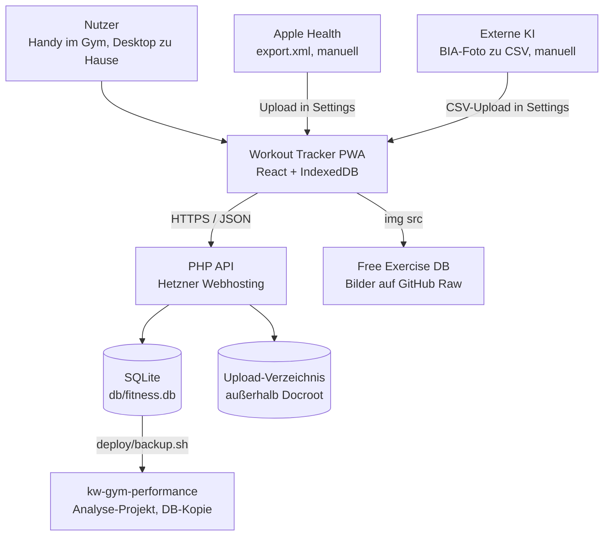

# 01 · Überblick

## Zweck

Ersatz für die App Gainsfire: Workouts einrichten, im Gym mobil tracken, zu Hause auswerten. Leitidee laut `CLAUDE.md` §1: erklärendes Coaching auf eigenen, exportierbaren Daten, ohne Abo. Version 1.0 steht seit 14.10.2026 (`README.md:8`), die Gainsfire-Historie ist importiert.

## Stack

| Bereich | Technik | Version | Beleg |
| :--- | :--- | :--- | :--- |
| UI | React, React Router | 19.2 / 7.18 | `frontend/package.json` |
| Build | Vite, TypeScript | 8.2 / 6.0 | `frontend/package.json` |
| Styling | Tailwind, shadcn-Komponenten auf `@base-ui/react`, Geist-Font | 4.3 / 1.7 | `frontend/package.json`, `frontend/components.json` |
| State | Zustand | 5.0 | `frontend/src/store/` |
| Offline | `idb`, `vite-plugin-pwa` (Workbox) | 8.0 / 1.3 | `frontend/src/lib/localDb.ts`, `frontend/vite.config.ts:12` |
| Charts | Nivo `line`, `radar`, `bar` | 0.99 | `frontend/package.json` |
| Backend | PHP mit `declare(strict_types=1)`, kein Composer | README: ≥ 8.1, lokal 8.5 | `api/index.php`, `README.md:18` |
| Daten | SQLite über PDO, MySQL als nominaler Fallback (s. R-14) | | `api/lib/Db.php:30-40` |
| Lint/Test | oxlint, `node --test`, eigener PHP-Testlauf | 1.75 | `frontend/package.json`, `api/tests/run.php` |

`@nivo/heatmap` und `@nivo/calendar` aus `CLAUDE.md` §3 sind nicht installiert. Heatmap und Kalender sind eigene Komponenten (`MuscleBodyMap.tsx`, `ConsistencyCalendar.tsx`).

## Laufzeitumgebung

| Ziel | Stand | Beleg |
| :--- | :--- | :--- |
| Web/PWA | installierbar, `display: standalone`, App-Shell im Precache | `frontend/vite.config.ts:20-34` |
| iOS | nur als PWA über den Browser. Keine native App | kein iOS-Projekt im Repo |
| Hosting | Hetzner Webhosting, FTP via `lftp`, kein SSH | `README.md:245-261`, `deploy/deploy.sh:159` |
| Daten-Server | `db/fitness.db`, per `db/.htaccess` gesperrt | `db/.htaccess` |

## Kontextdiagramm



Die App spricht zur Laufzeit nur mit der eigenen API und lädt Übungsbilder von GitHub Raw (`db/seed/exercises.php:101`). Apple Health und die KI-Auswertung der BIA-Scans sind Handarbeit über Datei-Uploads. Das Analyse-Projekt arbeitet auf Backups, nicht auf der Live-DB (`PROJECTS.md`, `scripts/training-review.py`).

## Build und Run

```bash
php db/migrate.php --password=<passwort>
php -S localhost:8000 -t . api/index.php
```

```bash
cd frontend && npm install && npm run dev
```

| Aufgabe | Befehl | Hinweis |
| :--- | :--- | :--- |
| Dev-Frontend | `npm run dev` | Port 5173, Proxy `/api` auf 8000 (`vite.config.ts:43-49`) |
| Build | `npm run build` | `tsc -b && vite build` |
| Typecheck | `npx tsc -b` | `tsc --noEmit -p .` prüft nichts (`PROCESS_LOG.md:540`) |
| Test Backend | `php api/tests/run.php` | Wegwerf-SQLite |
| Test Frontend | `npm test` | `frontend/tests/*.test.mjs` |
| Deploy | `./deploy/deploy.sh "notiz"` | nur nach Freigabe (`CLAUDE.md` §12), `--dry-run`, `--with-migration` |
| Backup | `./deploy/backup.sh` | Live-DB nach `backups/` |

Es gibt keine CI: Im Repo liegt kein `.github/`-Ordner. Die Quality Gates laufen von Hand.

## Deployment-Ablauf

`deploy/deploy.sh` erzeugt die Build-ID, zieht ein Backup und bricht bei Fehlern ab, baut das Frontend, stellt `deploy-upload/` aus einer Whitelist zusammen und lädt ohne `--delete` hoch (`deploy/deploy.sh:6-9,105-117,152-159`). Bei Schema-Änderungen startet `--with-migration` eine Migration per Einmal-Token (`README.md:330-342`).
