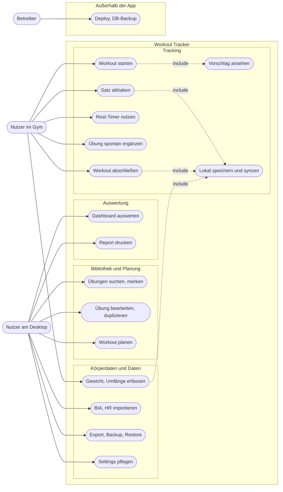
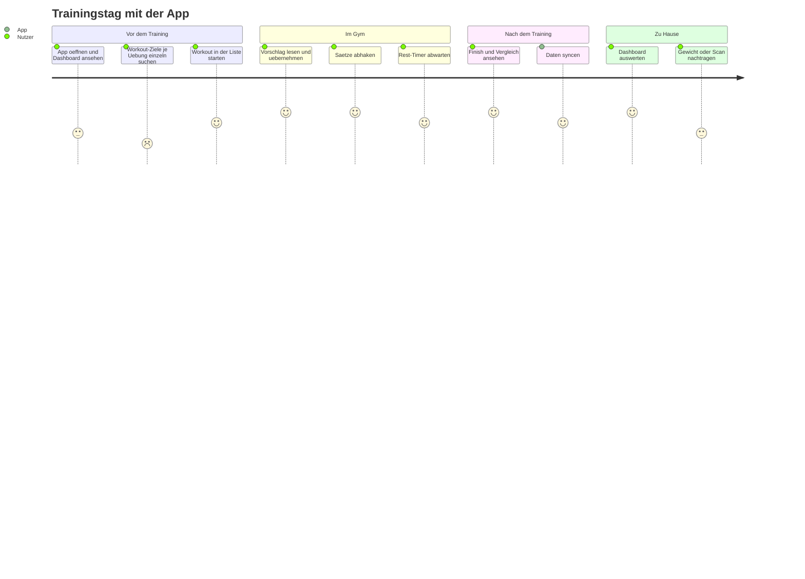

# 02 · Features

Status: **stabil** = in Benutzung, Logik nachvollziehbar, keine bekannten Lücken. **wackelig** = läuft, aber mit belegtem Risiko. **halbfertig** = Teile fehlen oder Daten kommen nie an.

Die Einstufung ist eine Code-Bewertung. Wie stabil sich ein Feature auf dem iPhone anfühlt, ist damit nicht gemessen (s. `09-open-questions.md`).

## Use Cases

Mermaid kennt keinen eigenen Use-Case-Typ, das Diagramm folgt der UML-Notation als Flowchart. Alle Akteure sind dieselbe Person in drei Rollen, die Trennung zeigt den Ort. Offline-first sind nur die Fälle mit `include` auf "Lokal speichern und syncen", Tracking startet zudem aus dem `cache`. Die übrigen Fälle setzen Netz voraus.

## Inventar

### Tracking

| Feature | Beschreibung | Screens | Dateien | Status |
| :--- | :--- | :--- | :--- | :--- |
| Workout starten | Start aus der Liste, Vorbelegung aus letzten Sätzen | `/workouts`, `/track/:id` | `pages/WorkoutsPage.tsx:44-55`, `pages/TrackingPage.tsx:115-153` | stabil, offline aus `lib/offlineCache.ts` |
| Übung im laufenden Workout | Nur für die Session, `workout_exercise_id = NULL`, Vorlage unverändert, Picker offline nutzbar (#165) | `/track/:id` | `store/useTrackingStore.ts`, `lib/offlineCache.ts` | neu |
| Übungsauswahl | Gruppen statt Varianten, zweite Ebene je Muskelgruppe (#169). Suche und Saved bleiben flach | alle Picker | `lib/exerciseGrouping.ts`, `api/lib/ExerciseFocus.php` | neu |
| Übungs-Merkliste | Bookmark im Detail-Sheet, Modus „Saved“ im Selector (#166) | `/exercises`, Picker | `components/ExerciseDetailSheet.tsx`, `components/ExerciseSelector.tsx` | neu |
| Sätze loggen | Gewicht/Reps, Abhaken schreibt `sets`-Zeile, Rückgängig per Soft-Delete | `/track/:id` | `store/useTrackingStore.ts:208-264` | stabil |
| Offline-Puffer | IndexedDB zuerst, dann Push | `/track/:id` | `lib/localDb.ts`, `lib/syncService.ts` | stabil |
| Offene Session fortsetzen | Mehrere offene Sessions, Resume, Discard, Neu | `/track/:id` | `pages/TrackingPage.tsx:135-237`, `lib/localDb.ts:77-82` | stabil, aber nur je Gerät |
| Rest-Timer | Absolute Endzeit, Ton, Vibration, Wake Lock | `/track/:id` | `pages/TrackingPage.tsx:167-193`, `lib/sound.ts`, `lib/wakeLock.ts` | stabil |
| Progressions-Vorschlag | Double Progression mit Begründung | `/track/:id`, Dashboard Exercise | `lib/progression.ts`, `pages/TrackingPage.tsx:71-88` | wackelig: Rundung (R-08), keine Tests (R-06) |
| Zusatz-Satz | Nur für die Session | `/track/:id` | `store/useTrackingStore.ts:198-206` | stabil |
| Abschluss | Volumen, Dauer, Vergleich, PR-Badges | Finish-Sheet | `store/useTrackingStore.ts:268-330`, `pages/TrackingPage.tsx:528-597` | stabil. iOS-Fix #155 ist live, auf iOS ungeprüft |
| RPE, Warm-up, Session-Notiz | Spalten da, keine Eingabe | keine | `store/useTrackingStore.ts:243-244`, `:225` | halbfertig: nie erfasst (R-09) |

### Bibliothek und Planung

| Feature | Beschreibung | Screens | Dateien | Status |
| :--- | :--- | :--- | :--- | :--- |
| Übungsbibliothek | FEDB plus eigene, Suche, Filter, Modus "My library" | `/exercises` | `pages/ExercisesPage.tsx`, `components/ExerciseSelector.tsx`, `api/lib/Repository/ExerciseRepository.php` | stabil |
| Berechnete Übungsnamen | Muskel + Bewegung + Equipment + Variante | überall | `api/lib/ExerciseNaming.php`, Dublette in `pages/ExerciseEditPage.tsx:241-325` | wackelig: Regeln doppelt (R-04) |
| Übung bearbeiten/duplizieren | Benennung, Bewegung, Variante, Kopie | `/exercises/:id/edit`, Detail-Sheet | `pages/ExerciseEditPage.tsx`, `components/ExerciseDetailSheet.tsx`, `pages/ExercisesPage.tsx:18-35` | wackelig: Muskeln nur lesbar, Löschen fehlt |
| Workouts | Anlegen, Modus, Sätze, Reihenfolge, Overrides | `/workouts/new`, `/workouts/:id/edit` | `pages/WorkoutEditPage.tsx`, `api/lib/Repository/WorkoutRepository.php` | stabil |
| Workout-Gruppen | Optionale Abschnitte | `/workout-groups` | `pages/WorkoutGroupsPage.tsx`, `lib/workoutGrouping.ts` | wackelig: nicht im Backup (R-03) |
| Workout archivieren | Spalte und Filter da, keine UI | keine | `api/lib/Repository/WorkoutRepository.php:16` | halbfertig: nur per Datenfix |
| Workout-Notizen | Spalte, Payload sendet sie nicht | keine | `pages/WorkoutEditPage.tsx:130-141` | halbfertig: Bearbeiten leert `notes` (R-10) |

### Auswertung

| Feature | Beschreibung | Screens | Dateien | Status |
| :--- | :--- | :--- | :--- | :--- |
| Overview | ACWR, Muskelkarte, Status, Recovery, Volumen, Konsistenz, Top-Übungen, Radar | `/dashboard` | `components/dashboard/OverviewScope.tsx` | stabil |
| Exercise-Scope | Last time, Target, Plateau, Rekorde, Verlauf, Ladder | `/dashboard` | `components/dashboard/ExerciseScope.tsx` | stabil |
| Workout-Scope | Radar, Entwicklung, Dauer, Vergleich | `/dashboard` | `components/dashboard/WorkoutScope.tsx`, `lib/workoutDevelopment.ts` | wackelig: Nur ein Teil der Sessions ist einem Workout zugeordnet (`04-data-model.md`) |
| Body-Scope | BIA-KPIs, Segmente, Trends, BMI | `/dashboard` | `components/dashboard/BodyScope.tsx`, `lib/biaMetrics.ts`, `lib/bodyProfile.ts` | stabil. Mehrere Punkte laut Backlog ungesehen auf iPhone |
| ACWR | 7 Tage vs. 28 Tage, Gesamtkörper | Overview, Exercise | `api/lib/MuscleVolume.php:171-190`, `lib/acwr.ts` | stabil |
| Volumen vs. MEV/MAV/MRV | Gewichtete Sätze je Region | Overview | `api/lib/MuscleVolume.php:47-140`, `api/lib/VolumeLandmarks.php`, `lib/muscleStatus.ts` | stabil |
| Plateau | Zwei Signale, nur im Client | Exercise | `lib/plateau.ts`, getestet in `frontend/tests/plateau.test.mjs` | stabil |
| Recovery-Tendenz | Anteil fallender Übungen | Overview | `api/lib/Recovery.php`, `components/RecoveryCard.tsx` | stabil. Schwellen laut Log gesetzt, nicht belegt (`PROCESS_LOG.md:522-523`) |
| Glossar | Begriffe erklärt | Dashboard | `lib/glossary.ts`, `components/GlossarySheet.tsx` | stabil |

### Körperdaten, Import, Export

| Feature | Beschreibung | Screens | Dateien | Status |
| :--- | :--- | :--- | :--- | :--- |
| Körpergewicht, Umfänge | Offline-first, Lesen per API | `/settings` | `pages/SettingsPage.tsx:503-686` | stabil |
| BIA-Import | CSV-Vorlage, idempotent, Detail-Sheet | `/settings` | `api/lib/BiaImport.php`, `api/endpoints/bia.php` | stabil |
| HR-Import | Apple-Health-XML auf Session-Fenster | `/settings` | `api/lib/HrImport.php`, `api/endpoints/hr.php` | halbfertig: Keine Anzeige, Füllgrad 0 %, Datei bleibt liegen (R-05) |
| CSV-Export | Eine Zeile pro Satz | `/settings` | `api/endpoints/export.php` | stabil |
| Druck-Report | `/report`, Druck als PDF | `/report` | `pages/ReportPage.tsx` | stabil |
| Backup/Restore | JSON der Nutzerdaten | `/settings` | `api/lib/Repository/BackupRepository.php` | wackelig: Lücken (R-03) |

### Plattform

| Feature | Beschreibung | Screens | Dateien | Status |
| :--- | :--- | :--- | :--- | :--- |
| Login | Ein Passwort, 30 Tage gleitend, Overlay bei Ablauf | `/login` | `api/lib/Auth.php`, `components/RequireAuth.tsx` | stabil, ohne Login-Bremse (R-13) |
| Settings | Theme, Modi, Ziele, Progression, Rest, Plateau, Recovery, Profil | `/settings` | `pages/SettingsPage.tsx` | stabil. `rounding_kg` ohne UI |
| Version-Check | Build-Vergleich, Banner oder Reload | global | `lib/versionCheck.ts`, `lib/versionDecision.ts` | stabil |
| Deploy-Sicherung | Backup vor Deploy, Whitelist | CLI | `deploy/*.sh` | stabil |
| Datenmigration | Gainsfire, Duplikate zusammenführen | CLI | `scripts/gainsfire-*.py`, `scripts/merge-duplicate-exercises.php` | stabil, nur Skript |

Pfade unter `pages/`, `components/`, `lib/`, `store/` beziehen sich auf `frontend/src/`.

## Ein Trainingstag

Der Tag läuft im Gym rund. Die Lücke liegt davor: Ein zusammenhängendes Briefing gibt es nicht, Ziele stehen je Übung im Exercise-Scope oder erst im Tracking. Die Scores sind eine Einschätzung aus dem Code, keine Messung.
