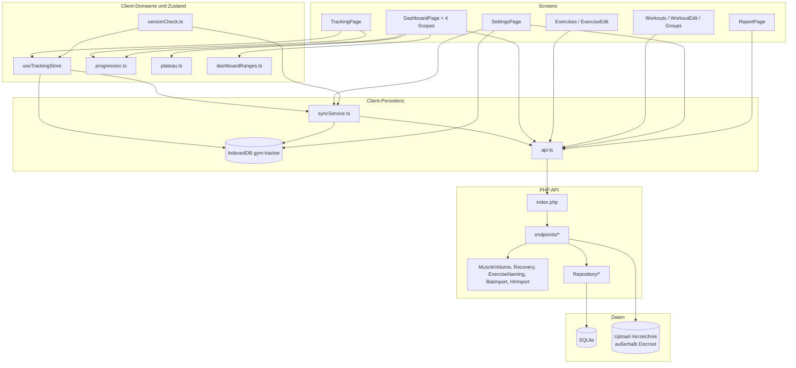
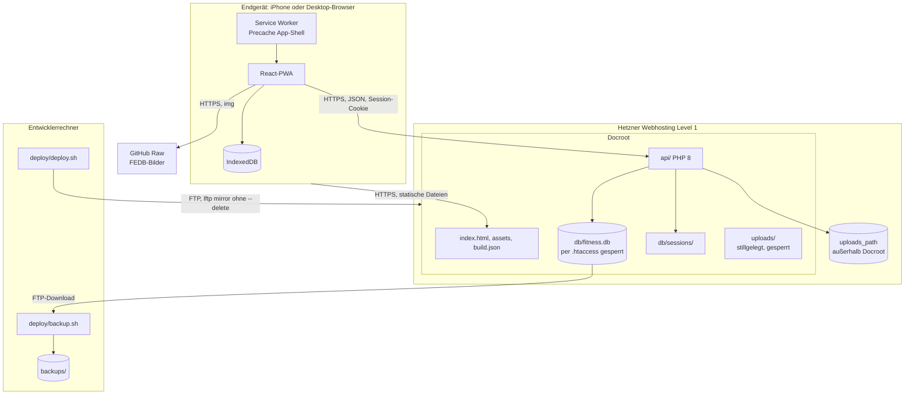
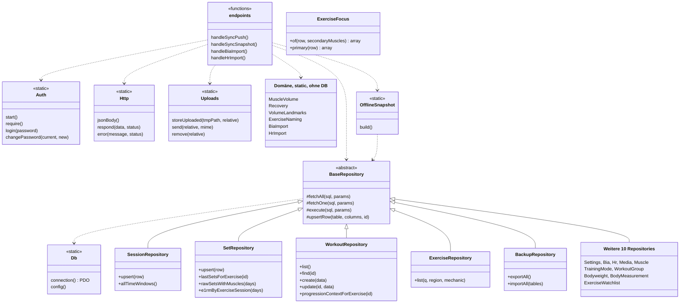

# 03 · Architektur

## Schichten

| Schicht | Ort | Verantwortung |
| :--- | :--- | :--- |
| Screens | `frontend/src/pages/`, `components/dashboard/` | Routing-Ziele, Datenabruf, ein Teil der Fachlogik |
| UI-Bausteine | `frontend/src/components/`, `components/ui/` | Karten, Charts, Picker, shadcn-Basis |
| Client-Domäne | `frontend/src/lib/` | Reine Regeln: Progression, Plateau, ACWR-Status, Zeitfenster |
| Client-Zustand | `frontend/src/store/` | Laufende Session, Auth, Theme, Glossar |
| Client-Persistenz | `lib/localDb.ts`, `lib/syncService.ts` | IndexedDB, Push-Queue |
| HTTP-Client | `lib/api.ts` | Fetch-Wrapper, 401-Event |
| Router | `api/index.php` | If-Kette, alle Routen |
| Handler | `api/endpoints/*.php` | Auth prüfen, Parameter begrenzen, antworten |
| Backend-Domäne | `api/lib/*.php` | `MuscleVolume`, `Recovery`, `ExerciseNaming`, `BiaImport`, `HrImport` |
| Repositories | `api/lib/Repository/` | SQL, LWW-Upsert |
| Speicher | `db/schema.sql`, `db/fitness.db`, `lib/Uploads.php` | Tabellen, private Dateien außerhalb des Docroots |

## Komponenten

Tracking und Körperdaten schreiben über IndexedDB. Workout-Liste und Tracking lesen mit Rückfall auf den Store `cache` (`lib/offlineCache.ts`), alle anderen Screens sprechen direkt mit der API und zeigen ohne Netz `LoadError`. Die Fachlogik ist geteilt: Volumen, ACWR und Recovery rechnen im Backend, Progression und Plateau im Client.

## Deployment

Es gibt genau einen Server-Prozess-Typ: PHP pro Request, kein Worker, kein Cron im Repo. ⚠️ Annahme: Apache wertet die `.htaccess`-Sperren aus (`09-open-questions.md`). `uploads_path` liegt außerhalb der FTP-Reichweite und damit in keinem Backup.

## Klassen Backend

Handler sind freie Funktionen, kein Controller-Objekt. Klassen hängen über `bootstrap.php` global zusammen, die Pfeile zeigen Nutzung, keinen Import. Der Sammelkasten fasst die Repositories ohne Besonderheit zusammen.

## Datenfluss

| Schritt | Trainingsdaten | Beleg |
| :--- | :--- | :--- |
| Eingabe | Entwurf nur im Speicher, Abhaken erzeugt die Zeile | `store/useTrackingStore.ts:120-124,208-264` |
| Lokal speichern | Session mit dem ersten Satz, dann Satz | `store/useTrackingStore.ts:217-254` |
| Übertragen | `POST /sync/push`, ungesyncte Zeilen aller vier Stores | `lib/syncService.ts:16-51` |
| Server | Upsert per ID, `updated_at` entscheidet | `api/endpoints/sync.php`, `api/lib/BaseRepository.php:43-63` |
| Auswerten | Repository liefert Rohzeilen, Domäne rechnet | `api/endpoints/dashboard.php:5-57` |
| Anzeigen | Scope lädt je Zeitraum, Client filtert auf lokale Tage | `lib/dashboardRanges.ts:150-150` |
| Exportieren | CSV, JSON-Backup, `/report` | `api/endpoints/export.php`, `backup.php` |

## Entscheidungen

| Entscheidung | Begründung | Beleg |
| :--- | :--- | :--- |
| Eine SQLite-Datei | Einfach, joinbar, portabel | `docs/konzept.md:75` |
| Local-first, Server nie erster Speicher | Datenverlust im Gym vermeiden | `docs/konzept.md:80` |
| Kein festes Zielgewicht | Ziel entsteht aus Historie plus Modus | `docs/konzept.md:86` |
| Dieselbe Engine für Tracking und Dashboard | Kein zweiter Vorschlag | `PROCESS_LOG.md:496`, `components/dashboard/ExerciseScope.tsx:157-167` |
| Sekundärmuskel ×0,5, e1RM nur primär | Bankdrücken soll den Arm-e1RM nicht setzen | `api/lib/MuscleVolume.php:34-39`, `PROCESS_LOG.md:263` |
| ACWR als Gesamtkörper-Last | Definition aus `CLAUDE.md` §8 | `api/lib/MuscleVolume.php:171-172` |
| Kein `done`-Flag | Zeile bedeutet: Satz gemacht | `store/useTrackingStore.ts:120-124` |
| Push-only statt voller Pull | Vorbelegung online als Best Effort | `README.md:89-93`, `PROCESS_LOG.md:46` |
| Restore überschreibt ohne LWW | Bewusste Wiederherstellung | `api/lib/Repository/BackupRepository.php:4-20` |
| BIA-Foto extern per KI | App bleibt schlank | `docs/konzept.md:85` |
| Kein PDF-Paket | Print-CSS reicht | `pages/ReportPage.tsx:33-37` |
| Keine Fremdschlüssel | Portabilität, Sync-Reihenfolge unkritisch | `db/schema.sql`, `api/endpoints/sync.php:4-8` |

## Querschnitt

- **Auth:** Jeder Handler ruft `Auth::require()` selbst auf. Kein zentraler Guard, aber alle Handler außer Login, Logout und Status tun es (`api/endpoints/`).
- **Zeit:** Serverzeit ist UTC. Lokale Tage entstehen über den `tz`-Parameter (`lib/dashboardRanges.ts:15`, `SessionRepository::timeZone`). Nicht alle Aufrufe senden ihn (R-12).
- **Rückwärtskompatibilität:** Weil eine installierte PWA kurz das alte Bundle fährt, liefert die API alte Felder weiter (`this_week`, `last_7_days`, `by_region`), und der Client fängt fehlende neue Felder ab (`lib/workoutDevelopment.ts:47-64`).
- **Fehlerbild:** `api.get` bricht nach 15 s ab. Screens mit Ladezustand zeigen dann `LoadError`, Workout-Liste und Tracking die lokale Kopie. Leere Listen ohne Hinweis bleiben bei `WorkoutGroupsPage` und Teilen der Dashboard-Scopes (R-16).
