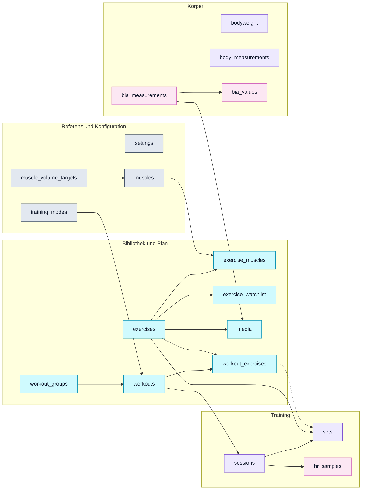
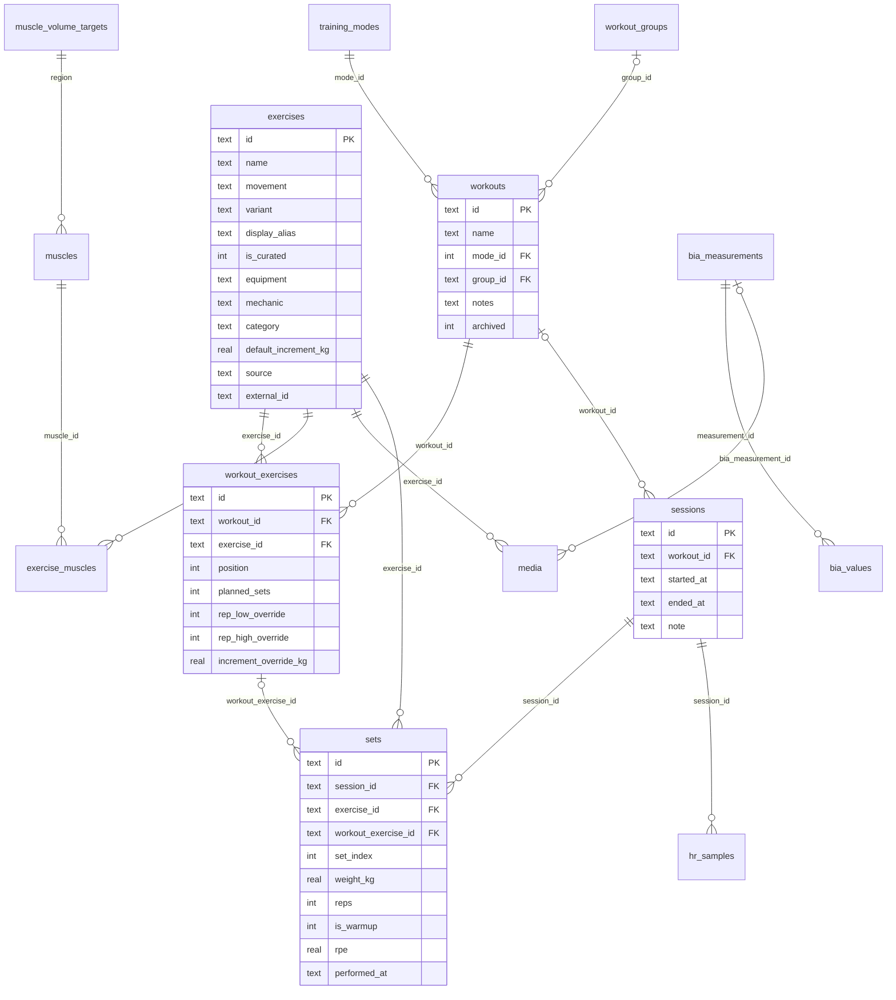
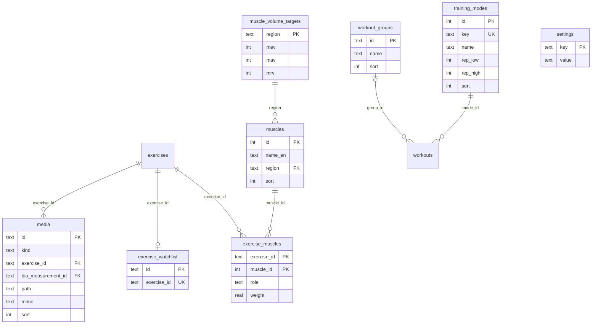
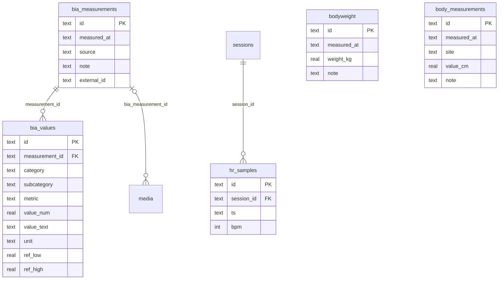
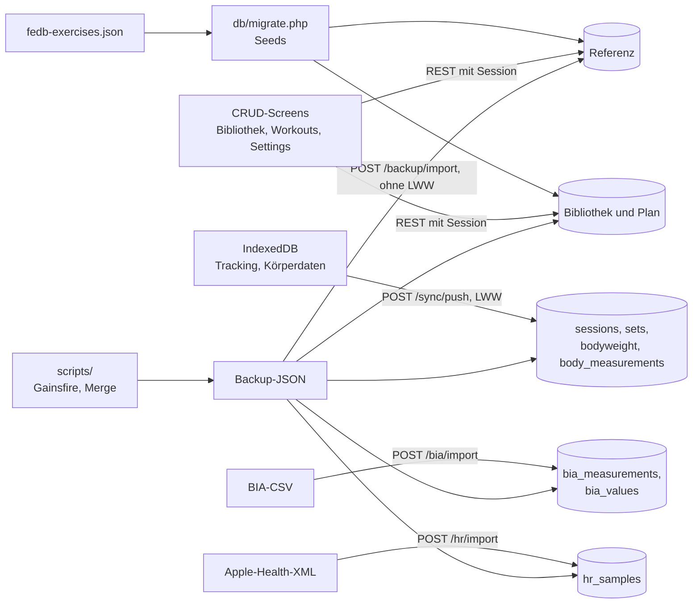
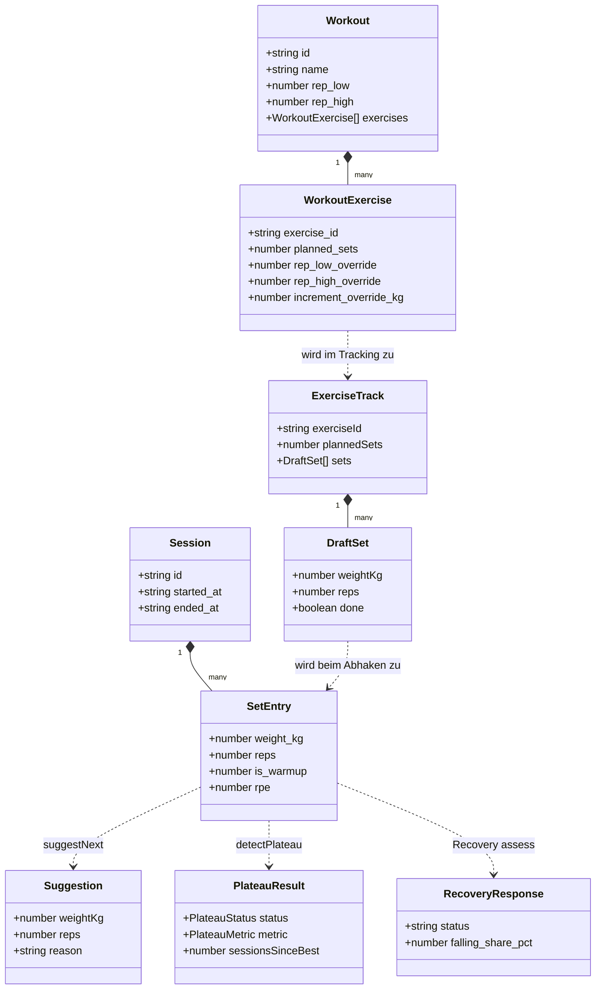
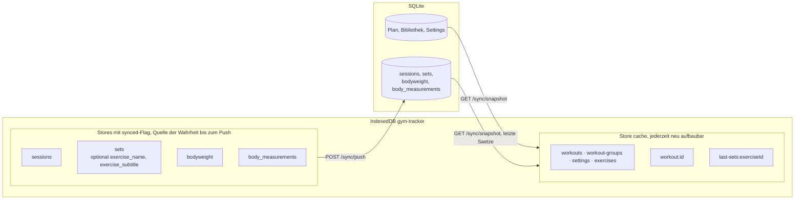

# 04 · Datenmodell

Quelle: `db/schema.sql`, Nachzügler per `ALTER TABLE` in `db/migrate.php:43-73`.

**Konventionen**

- Syncbare Tabellen: `id TEXT` (UUID), `created_at`, `updated_at` (ISO-8601 UTC ohne Millisekunden, `frontend/src/lib/time.ts`), `deleted_at`.
- Seed-Referenzen: `INTEGER`-PK.
- Das Schema deklariert weder `NOT NULL` noch `FOREIGN KEY`, außer PKs, `training_modes.key UNIQUE` und `exercise_watchlist.exercise_id NOT NULL UNIQUE`. **Pflicht** meint daher die Pflicht laut Code, nicht laut DB.

Beziehungen im Diagramm sind logisch, die DB erzwingt sie nicht. `PRAGMA foreign_keys=ON` in `api/lib/Db.php:40` wirkt deshalb nicht.

## Übersicht nach Domänen

Alle 18 Tabellen. Die Farbe zeigt, wie eine Zeile entsteht.

| Farbe | Entstehung | Tabellen |
| :--- | :--- | :--- |
| Grau | Seed bei der Migration, danach Pflege in Settings | 4 |
| Cyan | Online-CRUD über die API, Bibliothek zusätzlich aus dem FEDB-Seed | 7 |
| Violett | Offline-first: zuerst IndexedDB, dann `POST /sync/push` | 4 |
| Rosa | Datei-Import, keine manuelle Eingabe | 3 |

Pfeile lesen sich als "1 zu n" vom Elternteil zum Kind, gestrichelt heißt optional und nur bei Trainings aus dem Plan. `settings`, `bodyweight` und `body_measurements` haben keine Beziehung.

## ER-Diagramm

Der Kern von Plan und Training. Die Tabellen mit eigenen Feldern für Bibliothek und Körper folgen danach.

Zentrum ist die Kette `workouts → workout_exercises → sets ← sessions`. `bodyweight`, `body_measurements` und `settings` stehen allein, ihre Felder zeigen die Diagramme unten. `exercise_muscles` trägt die Gewichtung, aus der alle Regionsauswertungen entstehen.

### ER Bibliothek und Referenz

Felder von `exercises` und `workouts` stehen im Diagramm oben. `muscles.region` ist der Schlüssel in die Wochenziele, Regionen sind keine eigene Tabelle. Eine Übung hat höchstens eine Zeile in `exercise_watchlist`, Entfernen setzt `deleted_at`, erneutes Merken belebt die Zeile (`ExerciseWatchlistRepository.php`).

### ER Körper und Messwerte

`created_at`, `updated_at` und `deleted_at` sind in allen ER-Diagrammen weggelassen. `bia_values`, `hr_samples` und `media` führen sie nicht oder nur teilweise, sie gelten als unveränderliche Kindzeilen (`BackupRepository.php`).

## Schreibpfade

Nur `POST /sync/push` entscheidet per `updated_at`. CRUD, Importe und Restore schreiben direkt. Der Restore ist der einzige Pfad, der alle Bereiche berührt.

## Backup-Abdeckung

`BackupRepository::exportAll` gegen den Tabellenbestand:

| Tabelle | Im JSON-Backup | Hinweis |
| :--- | :--- | :--- |
| `settings`, `muscle_volume_targets` | ja | inkl. `password_hash` |
| `workouts`, `workout_exercises`, `exercise_watchlist` | ja | |
| `sessions`, `sets`, `bodyweight`, `body_measurements` | ja | |
| `bia_measurements`, `bia_values`, `hr_samples` | ja | |
| `exercises`, `exercise_muscles` | nur eigene | ohne `source = 'fedb'`, also ohne Kuration an FEDB-Übungen (R-03) |
| `media` | teilweise | BIA und eigene Übungen, Dateien selbst nicht |
| `workout_groups` | nein | R-03 |
| `training_modes` | nein | Rep-Bereiche sind in Settings editierbar, Änderungen gehen beim Neuaufbau verloren |
| `muscles` | nein | aus dem Seed reproduzierbar |

## Entitäten

### Referenz und Konfiguration

| Tabelle | Feld | Typ | Pflicht | Bedeutung |
| :--- | :--- | :--- | :--- | :--- |
| `settings` | `key`, `value` | TEXT | ja | Key-Value, alles Strings |
| `training_modes` | `id`, `key`, `name`, `rep_low`, `rep_high`, `sort` | INT/TEXT | ja | strength, hypertrophy, endurance |
| `muscles` | `id`, `name_en`, `region`, `sort` | INT/TEXT | ja | 17 Muskeln, 6 Regionen (`db/seed/muscle_taxonomy.php`) |
| `muscle_volume_targets` | `region`, `mev`, `mav`, `mrv` | TEXT/INT | ja | Wochenziele je Region, editierbar |

Settings-Schlüssel: `unit_system`, `default_increment_kg`, `rounding_kg`, `progression_trigger`, `rest_seconds`, `theme`, `plateau_sessions`, `recovery_drop_pct`, `recovery_watch_share_pct`, `recovery_deload_share_pct` (`db/seed/settings.php`), dazu `password_hash` und die Profilfelder `profile_height_cm`, `profile_birth_date`, `profile_sex` (`frontend/src/lib/bodyProfile.ts:5-9`).

### Bibliothek und Plan

| Tabelle | Feld | Typ | Pflicht | Bedeutung |
| :--- | :--- | :--- | :--- | :--- |
| `exercises` | `id`, `name` | TEXT | ja | `name` = Quellname, wird nicht umgeschrieben |
| | `movement`, `variant`, `display_alias` | TEXT | nein | Kuration, daraus der Anzeigename |
| | `is_curated` | INT | nein | abgeleitet aus `movement` |
| | `equipment`, `mechanic`, `category` | TEXT | nein | |
| | `default_increment_kg` | REAL | nein | |
| | `source`, `external_id` | TEXT | nein | `fedb` oder `custom` |
| `exercise_muscles` | `exercise_id`, `muscle_id`, `role`, `weight` | | ja | primary 1,0, secondary 0,5 |
| `media` | `id`, `kind`, `exercise_id`, `bia_measurement_id`, `path`, `mime`, `sort` | | teils | Bei FEDB eine externe URL |
| `workout_groups` | `id`, `name`, `sort` | | ja | |
| `workouts` | `id`, `name`, `mode_id` | | ja | |
| | `group_id`, `notes`, `archived` | | nein | |
| `workout_exercises` | `id`, `workout_id`, `exercise_id`, `position`, `planned_sets` | | ja | |
| | `rep_low_override`, `rep_high_override`, `increment_override_kg` | | nein | |

Regel: Ein Workout enthält jede Übung nur einmal. Das hängt am Picker und an `syncExercises`, der Zeilen per `exercise_id` abgleicht (`api/lib/Repository/WorkoutRepository.php:162-224`). Ein Unique-Index fehlt.

### Training

| Tabelle | Feld | Typ | Pflicht | Bedeutung |
| :--- | :--- | :--- | :--- | :--- |
| `sessions` | `id`, `started_at` | TEXT | ja | |
| | `workout_id` | TEXT | nein | fehlt bei Importen |
| | `ended_at` | TEXT | nein | `NULL` = offen |
| | `note` | TEXT | nein | nur Importe |
| `sets` | `id`, `session_id`, `exercise_id`, `set_index`, `weight_kg`, `reps`, `performed_at` | | ja | Zeile = Satz gemacht |
| | `workout_exercise_id` | TEXT | nein | Slot im Plan |
| | `is_warmup`, `rpe` | INT/REAL | nein | nie erfasst |

### Körper

| Tabelle | Feld | Typ | Pflicht | Bedeutung |
| :--- | :--- | :--- | :--- | :--- |
| `bodyweight` | `id`, `measured_at`, `weight_kg`, `note` | | `note` nein | |
| `body_measurements` | `id`, `measured_at`, `site`, `value_cm`, `note` | | `note` nein | waist, chest, hip, arm, thigh |
| `bia_measurements` | `id`, `measured_at`, `source`, `note`, `external_id` | | teils | Kopf eines Scans |
| `bia_values` | `id`, `measurement_id`, `category`, `subcategory`, `metric`, `value_num`, `value_text`, `unit`, `ref_low`, `ref_high` | | teils | Long-Format, deutsche Bezeichner aus der Vorlage (`api/lib/BiaImport.php:14-77`) |
| `hr_samples` | `id`, `session_id`, `ts`, `bpm` | | ja | ohne Soft-Delete |

Der Grundumsatz liegt als `bia_values`-Metrik `Grundumsatz (kcal)` vor und ist über `frontend/src/lib/biaMetrics.ts:18` zugänglich.

## Füllgrade

Live-Kopie vom 2026-10-26. Prozent bezogen auf aktive Zeilen (`deleted_at IS NULL`), sonst vermerkt.

| Feld | Füllgrad | Folge |
| :--- | :--- | :--- |
| `sets.rpe` | 0,0 % | Tracking schreibt fest `null` (`useTrackingStore.ts:244`) |
| `sets.is_warmup = 1` | 0,0 % | Tracking schreibt fest `0`. Alle Warmup-Filter sind wirkungslos |
| `sets.workout_exercise_id` | 47,0 % | Rest aus Importen |
| `sets.weight_kg = 0` | 3,8 % | Körpergewichts-Sätze ohne Lastangabe |
| Soft-gelöschte `sets` (`deleted_at` gesetzt, alle Zeilen) | 40,3 % | Batch-Grabsteine: nur 8 verschiedene `deleted_at`-Werte, frühester 2026-09-02. Kein Einfluss auf Auswertungen, die `deleted_at IS NULL` filtern |
| Gelöschte `sets` ohne Übungszeile | 82,8 % der gelöschten | Betrifft nur Grabsteine. `exercise_id` ist gefüllt, die Übung existiert nicht mehr |
| Aktive `sets` ohne Übung oder Session | 0,0 % | Aktiver Bestand ist sauber |
| `sessions.workout_id` gefüllt | 38,8 % | Der Rest ist `NULL`, kein toter Verweis. Betrifft nur Sessions von 2024-04-18 bis 2026-01-18, danach ist jede Session verknüpft |
| Sessions mit Verweis auf soft-gelöschtes Workout | 18,6 % | Verweis existiert, das Workout ist aber nicht mehr auswählbar |
| Sessions auf aktivem Workout | 20,2 % | Nur diesen Teil zeigt der Workout-Scope |
| `sessions.ended_at` | 99,2 % | |
| `sessions.note` | 95,5 % | Ein einheitlicher Import-Text, keine echte Notiz |
| `hr_samples` je Session | 0,0 % | HR-Import nie produktiv angekommen |
| `workouts.group_id` (alle Zeilen) | 37,9 % | |
| `workouts.archived` (alle Zeilen) | 10,3 % | Gesetzt ohne UI, also per Datenfix |
| `workouts.notes` (alle Zeilen) | 3,4 % | Seed-Demo oder Import ⚠️ Annahme |
| `workout_exercises`-Overrides (alle Zeilen) | 0,0 % | Rep-Range nur aus dem Modus |
| `exercises.is_curated` (alle Zeilen) | 16,0 % | |
| `exercises.default_increment_kg` (alle Zeilen) | 0,1 % | Globaler Schritt greift fast immer |
| `exercises.equipment` (alle Zeilen) | 91,3 % | |
| `exercises.mechanic` (alle Zeilen) | 90,1 % | |
| Aktive Übungen ohne Primärmuskel | 0,0 % | |
| `recovery_*`-Settings | fehlen live | Kein Migrationslauf seit Einführung ⚠️ Annahme. Der Code nutzt Defaults |
| Profil | nur `profile_birth_date` live | Für Nutrition fehlen Größe und Geschlecht |

## Domain-Objekte

Die Typen stehen in `frontend/src/types/index.ts`, die Entwurfsform in `store/useTrackingStore.ts:8-23`. `Suggestion` und `PlateauResult` sind berechnet und werden nie gespeichert. Das gilt auch für PR-Badges: Es gibt keinen PR-Verlauf.

## IndexedDB

DB `gym-tracker`, Version 3, Stores `sessions`, `sets`, `bodyweight`, `body_measurements`, jeweils `keyPath: id` plus `synced: boolean` (`frontend/src/lib/localDb.ts`). Dazu `cache` (`keyPath: key`): Kopie von Workouts, Gruppen, Settings und letzten Sätzen je Übung für den Offline-Start, wird nie gepusht und bei jedem `GET /sync/snapshot` komplett ersetzt. Seit #165 liegt auch die Übungsbibliothek im `cache`, die letzten Sätze für alle je trainierten Übungen.

### Client- und Server-Modell

Die beiden Hälften fließen gegenläufig: Die Queue schreibt nur zum Server, der `cache` liest nur von dort. Ein voller Pull fehlt, deshalb zeigt ein zweites Gerät fremde Sätze erst über die API, nicht über seine lokalen Stores. `synced` und die `exercise_*`-Hilfsfelder existieren nur lokal, der Server speichert bekannte Spalten.
