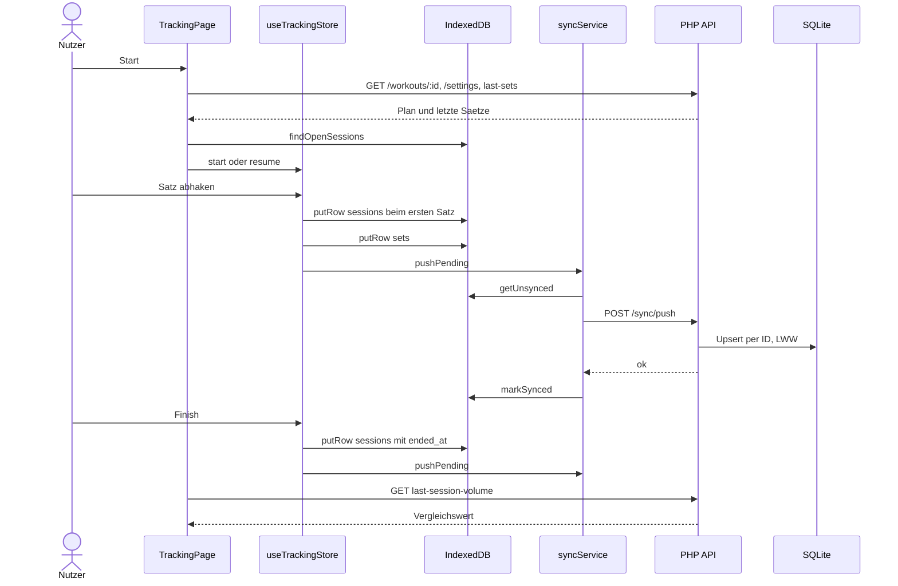
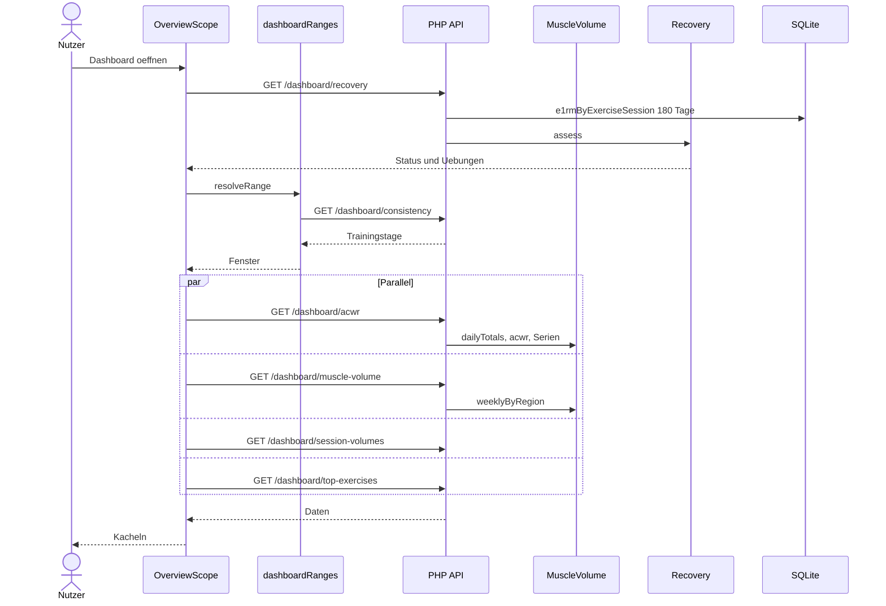
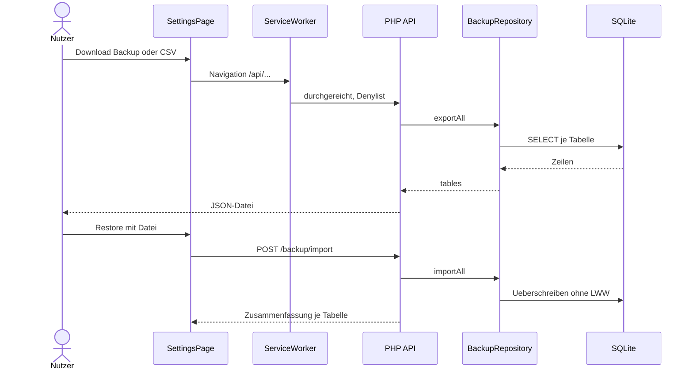

# 05 · API und Schnittstellen

Basis `/api`, JSON. Fehlerform `{"error": "..."}`. Routing: If-Kette in `api/index.php:28-141`, Reihenfolge ist relevant (`/exercises/naming-vocabulary` vor `/exercises/:id`). Alle Routen außer `/auth/login`, `/auth/logout`, `/auth/status` verlangen eine Session, sonst 401.

`tz` ist immer ein IANA-Name, Standard UTC. Spalte **Datei** ist relativ zu `api/endpoints/`.

## REST-Endpunkte

### Auth und Konfiguration

| Name | Input | Output | Datei |
| :--- | :--- | :--- | :--- |
| `POST /auth/login` | `{password}` | `{authenticated}` / 401 | `auth.php` |
| `POST /auth/logout` | – | `{authenticated:false}` | `auth.php` |
| `GET /auth/status` | – | `{authenticated}` | `auth.php` |
| `POST /auth/change-password` | `{current_password,new_password}` | `{ok}` | `auth.php` |
| `GET /settings` | – | Objekt ohne `password_hash` | `settings.php` |
| `PUT /settings` | Teilobjekt, beliebige Schlüssel | alle Settings | `settings.php` |
| `GET /training-modes` | – | `TrainingMode[]` | `reference.php` |
| `PUT /training-modes/:key` | `{rep_low,rep_high}` | `TrainingMode[]` | `reference.php` |
| `GET /muscles` | – | `Muscle[]`. Kein Aufrufer im Frontend | `reference.php` |
| `GET /muscle-volume-targets` | – | `MuscleVolumeTarget[]` | `reference.php` |
| `PUT /muscle-volume-targets/:region` | `{mev,mav,mrv}` | `MuscleVolumeTarget[]` | `reference.php` |

### Übungen

| Name | Input | Output | Datei |
| :--- | :--- | :--- | :--- |
| `GET /exercises` | `q, region, mechanic, curated=1, tracked=1` | `ExerciseListItem[]` | `exercises.php` |
| `POST /exercises` | `{id?,name,...,muscles[]}` | `Exercise` 201 | `exercises.php` |
| `GET /exercises/naming-vocabulary` | – | `{movements,variants}` | `exercises.php` |
| `GET /exercises/:id` | – | `Exercise` mit `muscles`, `media` | `exercises.php` |
| `PUT /exercises/:id` | Teilfelder | `Exercise` | `exercises.php` |
| `GET /exercises/:id/last-sets` | `exclude_session` | `SetEntry[]` | `exercises.php` |
| `GET /exercises/:id/progression-context` | – | `ProgressionContext` oder `null` | `exercises.php` |
| `GET /exercises/:id/history` | `limit, weeks` | `ExerciseHistoryEntry[]` | `exercises.php` |
| `GET /exercises/:id/session-summaries` | `limit, weeks` | `ExerciseSessionSummary[]` | `exercises.php` |

`DELETE /exercises/:id` existiert nicht.

### Workouts

| Name | Input | Output | Datei |
| :--- | :--- | :--- | :--- |
| `GET /workouts` | – | `WorkoutListItem[]`, ohne archivierte | `workouts.php` |
| `POST /workouts` | `{id?,name,mode_id,group_id,exercises[]}` | `Workout` 201 | `workouts.php` |
| `GET /workouts/recent` | `days` | `RecentWorkout[]` | `workouts.php` |
| `GET /workouts/:id` | – | `Workout` mit `exercises[]` | `workouts.php` |
| `PUT /workouts/:id` | wie POST | `Workout` | `workouts.php` |
| `DELETE /workouts/:id` | – | `{ok}` | `workouts.php` |
| `GET /workouts/:id/last-session-volume` | `exclude_session` | `PreviousSession` | `workouts.php` |
| `GET /workouts/:id/muscle-split` | `limit, weeks` | `{sessions[]}` | `workouts.php` |
| `GET /workout-groups` | – | `WorkoutGroup[]` | `workouts.php` |
| `POST /workout-groups` | `{id?,name,sort?}` | Gruppe 201 | `workouts.php` |
| `PUT /workout-groups/:id` | `{name?,sort?}` | Gruppe | `workouts.php` |
| `DELETE /workout-groups/:id` | – | `{deleted}` | `workouts.php` |

### Sync und Körperdaten

| Name | Input | Output | Datei |
| :--- | :--- | :--- | :--- |
| `POST /sync/push` | `{sessions[],sets[],bodyweight[],body_measurements[]}` | `{ok}` | `sync.php` |
| `GET /bodyweight` | `limit` | `Bodyweight[]` | `bodyweight.php` |
| `GET /body-measurements` | `site, limit` | `BodyMeasurement[]` | `bodymeasurements.php` |
| `GET /bia/template` | – | CSV | `bia.php` |
| `POST /bia/import` | Multipart `file` | `{imported,skipped}` | `bia.php` |
| `GET /bia/series` | `limit` | `BiaSeriesEntry[]` | `bia.php` |
| `GET /bia/latest` | – | `{measurement,values}` | `bia.php` |
| `GET /bia/measurements` | `limit` | `BiaMeasurement[]` | `bia.php` |
| `GET /bia/measurements/:id` | – | `{measurement,values}` | `bia.php` |
| `DELETE /bia/measurements/:id` | – | `{ok}` | `bia.php` |
| `POST /hr/import` | Multipart `file` | `{matched,sessions_touched}`. Datei liegt nur während des Requests im Upload-Verzeichnis | `hr.php` |
| `GET /media/:id` | – | Datei aus dem Upload-Verzeichnis, 404 für URL-Zeilen. Bilder inline, Rest als Download | `media.php` |
| `GET /uploads/status` | – | `{writable,outside_docroot}`, ohne Pfad | `media.php` |

Es gibt kein Lese-Endpoint für `hr_samples`, keines für Sessions als Liste und kein Schreib-Endpoint für Körperdaten außer Sync.

### Dashboard

| Name | Input | Output | Datei |
| :--- | :--- | :--- | :--- |
| `GET /dashboard/muscle-volume` | `weeks, days, tz` | `{regions[]}` | `dashboard.php` |
| `GET /dashboard/acwr` | `weeks, days, tz` | `{acute_kg,chronic_kg,ratio,weekly_series,daily_series}` | `dashboard.php` |
| `GET /dashboard/recovery` | – | `RecoveryResponse` | `dashboard.php` |
| `GET /dashboard/training-load` | `weeks, tz` | `{weekly_volume,weekly_sessions}` | `dashboard.php` |
| `GET /dashboard/consistency` | `days, tz` | `{dates[]}` | `dashboard.php` |
| `GET /dashboard/session-volumes` | `days, tz` | `{sessions[]}` | `dashboard.php` |
| `GET /dashboard/top-exercises` | `weeks, limit` | `TopExercise[]` | `dashboard.php` |

### Export

| Name | Input | Output | Datei |
| :--- | :--- | :--- | :--- |
| `GET /backup/export` | – | JSON-Download, inkl. `password_hash` | `backup.php` |
| `POST /backup/import` | Multipart `file` | `{tables:{...}}` | `backup.php` |
| `GET /export/training-log.csv` | – | CSV, eine Zeile je Satz | `export.php` |

## Interne Funktionen

### Backend

| Name | Input | Output | Datei |
| :--- | :--- | :--- | :--- |
| `MuscleVolume::weeklyByRegion` | Rohzeilen, Wochen, Fenster, tz | Metriken je Region | `api/lib/MuscleVolume.php:47` |
| `MuscleVolume::dailyTotals` | Satzzeilen, tz | `date => kg` | `api/lib/MuscleVolume.php:159` |
| `MuscleVolume::acwr` | Tageslast, Datum | `{acute_kg,chronic_kg,ratio}` | `api/lib/MuscleVolume.php:173` |
| `Recovery::assess` | Bestwerte je Übung/Session, Schwellen | Status, Übungen | `api/lib/Recovery.php:30` |
| `VolumeLandmarks::regionTargets` | Muskeln | Ziele je Region | `api/lib/VolumeLandmarks.php:43` |
| `ExerciseNaming::displayName` | Übungszeile | Titel | `api/lib/ExerciseNaming.php:453` |
| `ExerciseNaming::decorateAllJoined` | Zeilen mit Präfix | Zeilen mit Anzeigename | `api/lib/ExerciseNaming.php:631` |
| `BiaImport::parse` | CSV | Long-Format | `api/lib/BiaImport.php:92` |
| `HrImport::matchFromAppleHealthXml` | Pfad, Fenster | Samples | `api/lib/HrImport.php:17` |
| `BaseRepository::upsertRow` | Tabelle, Spalten, ID | – | `api/lib/BaseRepository.php:43` |
| `SetRepository::e1rmByExerciseSession` | Tage | Bestwerte | `api/lib/Repository/SetRepository.php:334` |
| `SetRepository::lastSetsForExercise` | Übung, Ausschluss | Sätze | `api/lib/Repository/SetRepository.php:41` |
| `WorkoutRepository::progressionContextForExercise` | Übung | Rep-Range, Schritt | `api/lib/Repository/WorkoutRepository.php:45` |

### Frontend

| Name | Input | Output | Datei |
| :--- | :--- | :--- | :--- |
| `suggestNext` | letzte Sätze, Range, Schritt, Rundung, Trigger | `Suggestion` | `lib/progression.ts:27` |
| `detectPlateau` | Verlauf, Schwelle | `PlateauResult` | `lib/plateau.ts:81` |
| `acwrStatus` | Ratio | Farbe, Label | `lib/acwr.ts:19` |
| `statusFor` | Sätze, MEV, MAV, MRV | Ampel | `lib/muscleStatus.ts:8` |
| `epley1RM` | kg, Reps | e1RM | `lib/metrics.ts:3` |
| `resolveRange` | Bereich | Fenster, Tage | `lib/dashboardRanges.ts:130` |
| `putRow`, `getUnsynced`, `markSynced` | Store, Zeile | IndexedDB | `lib/localDb.ts:48,63,93` |
| `findOpenSessions` | Workout | offene Sessions | `lib/localDb.ts:77` |
| `pushPending` | – | Sync-Lauf | `lib/syncService.ts:16` |
| `useTrackingStore` | Aktionen | Session-Zustand | `store/useTrackingStore.ts:128` |
| `checkForNewVersion` | – | Reload oder Banner | `lib/versionCheck.ts:129` |

Unter `lib/`, `store/` ist `frontend/src/` gemeint.

## Skripte

| Name | Input | Output | Datei |
| :--- | :--- | :--- | :--- |
| Migration | `--password, --db, --force` | Schema, Seeds | `db/migrate.php` |
| Gainsfire-Import | Export, Ziel-DB | Backup-JSON | `scripts/gainsfire-*.py` |
| Duplikate mergen | DB | Backup-JSON | `scripts/merge-duplicate-exercises.php` |
| Frühe Historie | DB | Backup-JSON | `scripts/early-history-library.py` |
| Trainings-Review | DB-Kopie | HTML | `scripts/training-review.py` |
| Dashboard-Export | DB, Template | HTML | `scripts/export-dashboard.py` |
| Titel-Export | DB | Liste | `scripts/export-exercise-titles.php` |
| Body-Pfade | `docs/references/body.svg` | `bodyPaths.ts` | `scripts/build-body-paths.py` |

Zwei Skripte im Muster "DB-Kopie rein, HTML raus" (`training-review.py`, `export-dashboard.py`) rechnen Auswertung in Python nach. Das ist eine zweite Implementierung außerhalb der App.

## Externe Dienste

| Dienst | Richtung | Beleg |
| :--- | :--- | :--- |
| GitHub Raw (FEDB-Bilder) | Browser lädt Bilder | `db/seed/exercises.php:101`, `components/ExerciseDetailSheet.tsx` |
| Hetzner FTP | Deploy, Backup | `deploy/deploy.sh`, `deploy/backup.sh` |

Es gibt keine weiteren Laufzeit-Dienste: keine Telemetrie, keine KI-API.

## Kern-Flows

### Workout loggen

Nur der Start braucht zwingend Netz, das Abhaken nicht. Schlägt der Push fehl, bleiben die Zeilen ungesynct und der nächste Auslöser versucht es erneut. Auslöser sind App-Start, `online`, jede Satz-Aktion und Finish.

### Auswertung und Dashboard

Der Overview macht einen Bereichs-Lauf mit fünf Requests plus Recovery. Jede Zahl wird pro Aufruf aus Rohdaten berechnet, einen Cache gibt es nicht. Der Exercise-Scope arbeitet ähnlich und rechnet Target und Plateau im Client.

### Export

Downloads sind einfache `<a href>`-Links, die der Service Worker durchlässt (`vite.config.ts:13-18`). CSV läuft gleich, nur über `exportRows()`. Der Druck-Report liest über die Dashboard-Endpunkte und nutzt `window.print()`.
