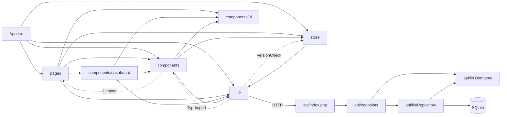
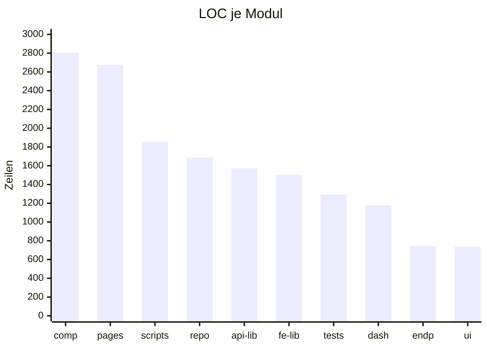
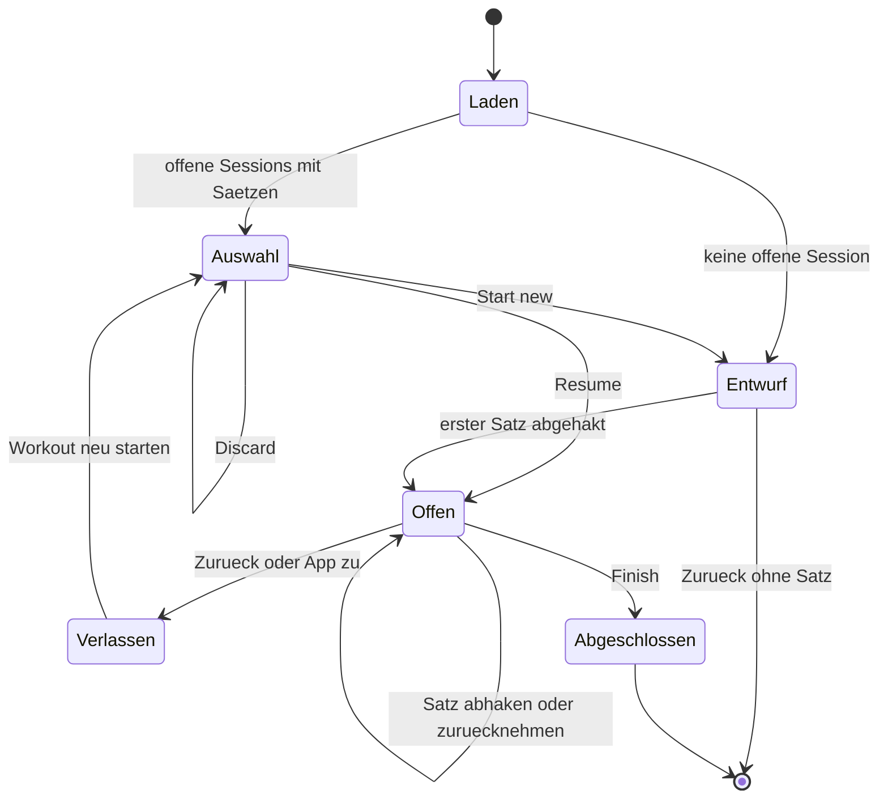
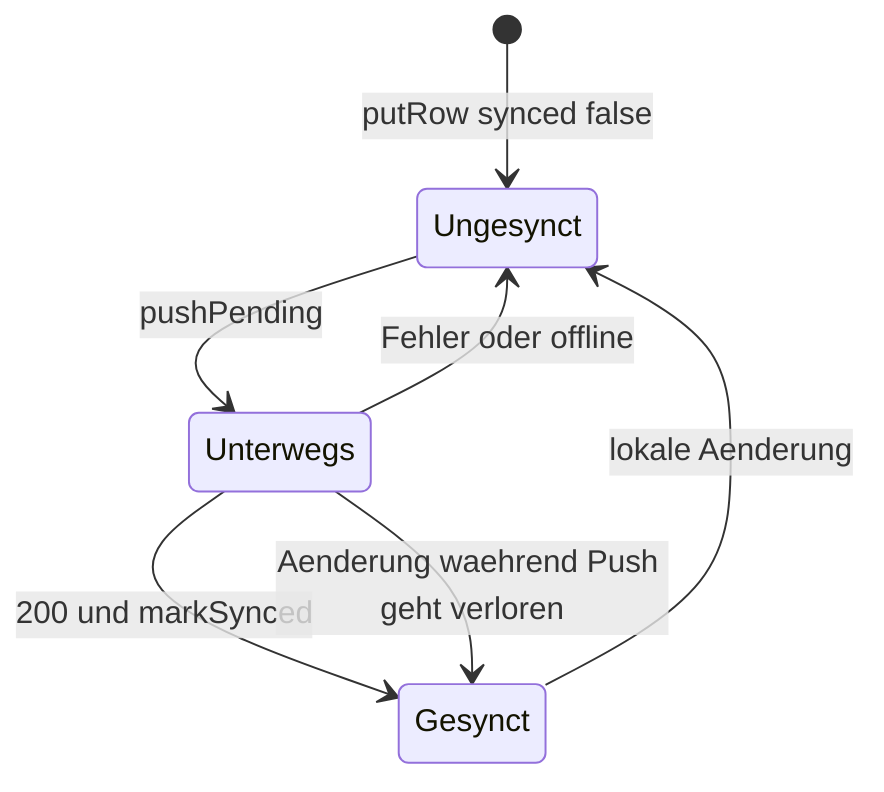

# 06 · Code-Struktur

## Verzeichnisbaum (Tiefe 3)

Ohne `node_modules`, `dist`, `backups`, `uploads`, `deploy-upload`.

```text
kw-gym-tracker/
├── CLAUDE.md · README.md · BACKLOG.md · PROCESS_LOG.md · DEPLOYMENTS.md
├── api/
│   ├── index.php · bootstrap.php · config.php · .htaccess
│   ├── endpoints/        13 Handler-Dateien
│   ├── lib/              Domäne + Infrastruktur
│   │   └── Repository/   13 Repositories
│   └── tests/run.php
├── db/
│   ├── schema.sql · migrate.php · .htaccess
│   └── seed/             Muskeln, Modi, Settings, FEDB, Naming, Demo-Workout
├── deploy/               deploy.sh, backup.sh, restore.sh, upload.sh, run-*.php, check-env.php
├── docs/
│   ├── architecture/     diese Doku
│   ├── references/       UX-Prototyp, Chart-Lab, body.svg
│   └── *.md              Konzept, Strategie, Datenmodell, Landmarks
├── frontend/
│   ├── public/           Icons, .htaccess
│   ├── tests/            2 Testdateien
│   └── src/
│       ├── App.tsx · main.tsx · index.css
│       ├── pages/        10 Screens
│       ├── components/   Bausteine, dashboard/, ui/
│       ├── lib/          Domäne + Infrastruktur
│       ├── store/        4 Zustand-Stores
│       └── types/        index.ts
├── scripts/              Importe, Merges, Reviews
└── uploads/              stillgelegt, nur .htaccess
```

## Einstiegspunkte

| Einstieg | Datei |
| :--- | :--- |
| Frontend | `frontend/index.html`, `frontend/src/main.tsx`, `frontend/src/App.tsx` |
| API | `api/index.php`, `api/.htaccess` |
| Migration | `db/migrate.php`, `deploy/run-migration.php` |
| Deploy | `deploy/deploy.sh` |
| Tests | `api/tests/run.php`, `frontend/tests/*.test.mjs` |

## Routen

| Pfad | Screen | Shell |
| :--- | :--- | :--- |
| `/login` | `LoginPage` | keine |
| `/` | Redirect auf `/dashboard` | |
| `/dashboard` | `DashboardPage` | `AppShell` |
| `/exercises` | `ExercisesPage` | `AppShell` |
| `/exercises/:id/edit` | `ExerciseEditPage` | `AppShell` |
| `/workouts` | `WorkoutsPage` | `AppShell` |
| `/workouts/new`, `/workouts/:id/edit` | `WorkoutEditPage` | `AppShell` |
| `/workout-groups` | `WorkoutGroupsPage` | `AppShell` |
| `/settings` | `SettingsPage` | `AppShell` |
| `/track/:workoutId` | `TrackingPage` | `TrackShell` |
| `/report` | `ReportPage` | keine |

Beleg: `frontend/src/App.tsx:71-89`. Alle außer `/login` liegen hinter `RequireAuth`.

## Kennzahlen je Modul

Gezählt per Skript über getrackte `.ts`, `.tsx`, `.php`, `.py`, `.sh`. **Funktionen** ist eine Regex-Zählung und damit eine Näherung. Bei Komponenten sind Pascal-Case-Funktionen gezählt.

| Modul | Dateien | LOC | Funktionen | Komponenten | Importe |
| :--- | ---: | ---: | ---: | ---: | ---: |
| `frontend/components` | 37 | 2802 | 74 | 41 | 118 |
| `frontend/pages` | 10 | 2673 | 67 | 21 | 122 |
| `scripts` | 9 | 1856 | 45 | 0 | 49 |
| `api/Repository` | 13 | 1687 | 81 | 0 | 0 |
| `api/lib` | 11 | 1574 | 50 | 0 | 3 |
| `frontend/lib` | 27 | 1503 | 89 | 0 | 23 |
| `api/tests` | 1 | 1292 | 1 | 0 | 2 |
| `frontend/components/dashboard` | 5 | 1177 | 19 | 6 | 80 |
| `api/endpoints` | 13 | 742 | 54 | 0 | 57 |
| `frontend/components/ui` | 11 | 736 | 39 | 39 | 33 |
| `db` | 9 | 594 | 1 | 0 | 5 |
| `deploy` | 7 | 579 | 0 | 0 | 4 |
| `frontend/store` | 4 | 445 | 2 | 0 | 11 |
| `frontend/types` | 1 | 428 | 0 | 0 | 0 |
| `api/root` | 3 | 178 | 0 | 0 | 14 |
| `frontend/root` | 3 | 117 | 2 | 1 | 26 |
| `frontend/tests+config` | 1 | 51 | 0 | 0 | 5 |
| **Summe** | **165** | **18434** | | | |

`frontend/tests/*.test.mjs` zählt nicht mit, die Dateiendung lag außerhalb der Zählung. Bei `api/*` zählt **Importe** nur `require`, weil Klassen über `bootstrap.php` global sind.

## Größte Dateien

| Datei | LOC | Funktionen | Importe | Einordnung |
| :--- | ---: | ---: | ---: | :--- |
| `api/tests/run.php` | 1292 | 1 | 2 | ein Lauf ohne Struktur |
| `frontend/src/pages/SettingsPage.tsx` | 925 | 24 | 24 | 10 Komponenten in einer Datei |
| `api/lib/ExerciseNaming.php` | 635 | 15 | 0 | Regeltabellen |
| `frontend/src/pages/TrackingPage.tsx` | 600 | 12 | 20 | Kern, Logik und UI gemischt |
| `frontend/src/types/index.ts` | 428 | 0 | 0 | alle Typen, Fan-in 35 |
| `frontend/src/components/dashboard/ExerciseScope.tsx` | 398 | 9 | 18 | Laden, Rechnen, Rendern |
| `api/lib/Repository/SetRepository.php` | 372 | 13 | 0 | Sammelbecken für Auswertung |
| `frontend/src/components/ExerciseSelector.tsx` | 361 | 8 | 11 | Hook und UI |
| `frontend/src/pages/WorkoutEditPage.tsx` | 345 | 9 | 12 | |
| `frontend/src/store/useTrackingStore.ts` | 333 | 1 | 6 | |

## Modulgrenzen

| Regel | Stand |
| :--- | :--- |
| Frontend ruft API nur über `lib/api.ts` | eingehalten, außer `<a href>`-Downloads und `build.json` |
| `lib/` ist UI-frei | fast: `lib/workoutDevelopment.ts` importiert einen Typ aus `components/MetricTrendPanels` |
| Handler enthalten kein SQL | eingehalten |
| Repositories enthalten keine Fachregeln | teilweise: e1RM steckt als SQL in `SetRepository` |
| Domäne im Backend ohne DB | eingehalten bei `MuscleVolume`, `Recovery`, `ExerciseNaming` |
| Tiefe Fan-ins | `@/types` 35, `@/lib/api` 20, `ui/card` 17, `ui/button` 14 |

## Abhängigkeiten



Die gestrichelten Kanten laufen gegen die Schichtung: `RequireAuth` importiert `LoginPage`, `workoutDevelopment` einen Komponententyp, `versionCheck` den Tracking-Store. Das sind kleine, begrenzte Zyklen. Im Backend ist die Reihenfolge sauber, die Klassen hängen aber über globales Laden zusammen.

## LOC je Modul



Frontend-Screens und Komponenten stellen den größten Teil. Beachtlich sind die 1856 Zeilen `scripts/`: Einmal-Importe, die weiter im Repo liegen. Die Module unterhalb von 700 Zeilen sind nicht dargestellt.

## Zustandsbehaftete Flows

### Tracking-Session



`Entwurf` schreibt nichts, erst der erste Haken legt die Session an (`store/useTrackingStore.ts:217-233`). `Verlassen` ist kein Fehler: Die Session bleibt mit `ended_at = NULL` lokal offen. Abgeschlossene Sessions lassen sich nicht wieder öffnen.

### Sync einer Zeile



Die letzte Kante ist Befund R-02: `markSynced` prüft nicht, ob sich die Zeile während des Requests geändert hat. Es gibt keinen Retry-Timer, die Queue läuft nur bei den vier Auslösern an.

## Tests

| Bereich | Umfang | Lücke |
| :--- | :--- | :--- |
| Backend | 273 `check()`, 1 rot | Endpunkte und Auth ungetestet, nur Repositories und Domäne |
| Frontend | 10 Tests (`chartTicks`, `plateau`) | `progression`, `syncService`, `localDb`, Tracking-Store ungetestet |
| E2E | keine | |
| CI | keine | |
| Typecheck | `npx tsc -b` grün | |
| Lint | oxlint: Warnungen `set-state-in-effect`, `purity`, `only-export-components` | |

Der rote Test `recentDates uses the local start day` (`api/tests/run.php:451`) ist ein Testfehler: Er setzt `22:30Z` und erwartet den Folgetag in Berlin. Das stimmt nur bei Sommerzeit, im Winter ist es 23:30 am selben Tag. Der Code ist nicht betroffen.
