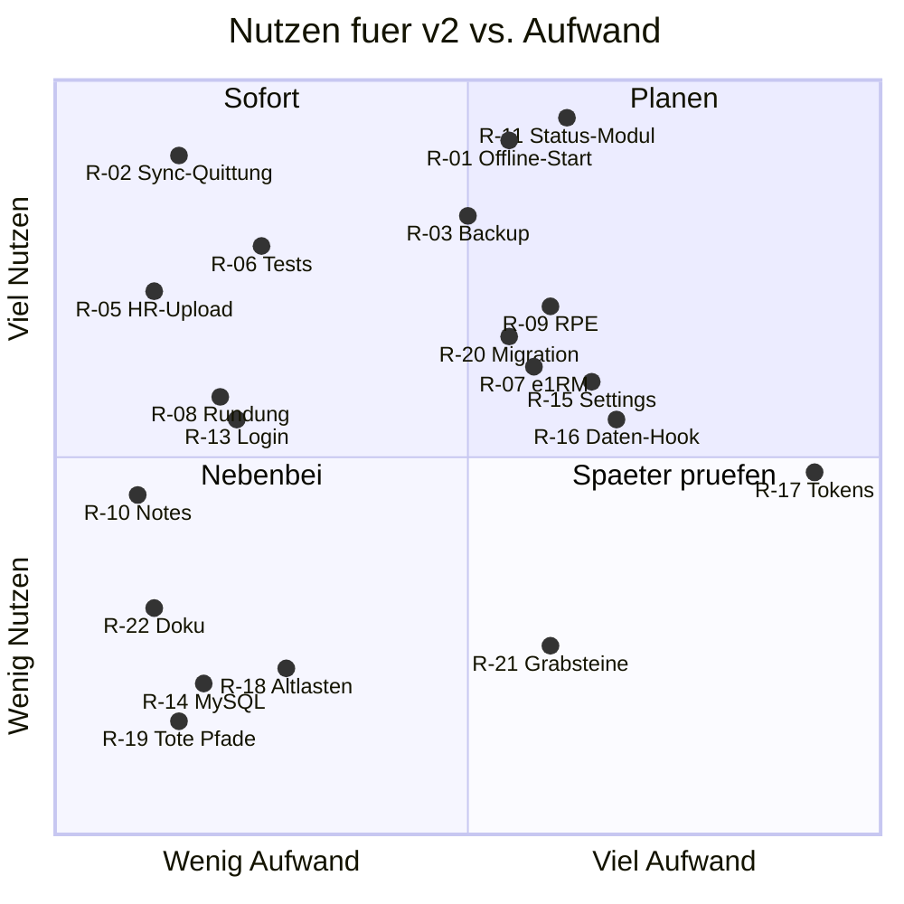

# 07 · Refactoring-Befunde

Sortiert nach Nutzen für v2. Aufwand: S bis ca. 1 Session, M mehrere, L eigener Abschnitt. Befunde sind durch Code-Lesen belegt, nicht durch Reproduktion im Live-Betrieb, außer wo vermerkt.

| ID | Befund | Ort | Schwere | Aufwand | Empfehlung |
| :--- | :--- | :--- | :--- | :--- | :--- |
| R-01 | Workout-Start braucht Netz. `load()` wartet auf `GET /workouts/:id` und `/settings` ohne `catch`, also bleibt der Screen offline auf "Loading". Die Workout-Liste ist offline leer. Kein Runtime-Caching für `/api`. Verletzt `CLAUDE.md` §2 teilweise | `pages/TrackingPage.tsx:115-155`, `pages/WorkoutsPage.tsx:21-28`, `vite.config.ts:12-19`, `lib/localDb.ts:9-19` | hoch | M | Workouts, Settings und letzte Sätze beim Online-Start in IndexedDB spiegeln. Liefert auch die Grundlage fürs Briefing im Gym |
| R-02 | `markSynced` setzt `synced: true` ohne Versionsvergleich. Wird eine Zeile während des Requests geändert (Satz abgehakt und zurückgenommen), gilt die neue Fassung als gesynct und erreicht den Server nie. Zudem bricht `pushPending` still ab, wenn schon ein Lauf aktiv ist, dann bleibt z. B. das Finish bis zum nächsten Auslöser liegen | `lib/syncService.ts:17-19,40-45`, `lib/localDb.ts:93-104` | hoch | S | Nur markieren, wenn `updated_at` unverändert ist. Nach Laufende prüfen, ob Neues wartet. Tests ergänzen (R-06) |
| R-03 | Backup unvollständig: `workout_groups` fehlt, Kuration an FEDB-Übungen (`source = 'fedb'`) und deren Muskelzuordnung ebenfalls. FEDB-IDs sind je Installation zufällig, Sätze zeigen nach Neuaufbau ins Leere. `README.md` nennt das Backup "vollständig". Die DB-Datei aus `deploy/backup.sh` ist derzeit die einzige echte Sicherung | `api/lib/Repository/BackupRepository.php:25-28,38`, `db/seed/exercises.php:50`, `README.md:115` | hoch | M | `workout_groups` aufnehmen, Exercises vollständig sichern oder FEDB-IDs deterministisch machen. Vor neuen v2-Tabellen klären |
| R-04 | Namensregeln doppelt: PHP und Editor-Vorschau pflegen Labels und Sonderfälle getrennt | `api/lib/ExerciseNaming.php:19-69`, `pages/ExerciseEditPage.tsx:241-325` | mittel | S | Vorschau-Endpoint oder berechneten Titel vom Server holen |
| R-05 | HR-Upload bleibt als `uploads/apple-health-export.xml` im Docroot liegen. `uploads/` hat keine `.htaccess`. Eine erfolgreiche Datei wäre ohne Login abrufbar ⚠️ Annahme: Host liefert `/uploads` aus. Live liegt laut Backup vom 26.10. nur `.gitkeep`, das Risiko greift also erst beim nächsten Import. Daten werden zudem nirgends angezeigt | `api/endpoints/hr.php:21-24`, `deploy/deploy.sh:115-117` | hoch | S | Nach Import löschen, `uploads/.htaccess` ausliefern. Feature anzeigen oder einfrieren |
| R-06 | Progressions-Engine und Sync ohne Tests, obwohl `CLAUDE.md` §13 das fordert. Keine CI. Der rote Test gewöhnt ans Ignorieren | `frontend/tests/`, `api/tests/run.php:451` | hoch | S | Tests für `suggestNext`, `pushPending`. Testdatum feste Zone. Kleiner CI-Lauf |
| R-07 | e1RM-Formel an sieben Stellen, teils SQL, teils PHP, teils TS. Warmup- und Bodyweight-Regeln variieren je Query | `SetRepository.php` (4×), `MuscleVolume.php:77`, `endpoints/export.php`, `lib/metrics.ts` | mittel | M | Eine SQL-Konstante plus eine PHP-Funktion. Für Briefing wichtig, weil dort alles zusammenkommt |
| R-08 | Rundung schluckt kleine Schritte: `rounding_kg` 2,5 und Schritt 1 kg ergeben aus 20 kg wieder 20 kg, die Begründung sagt trotzdem "+1kg". `rounding_kg` hat keine UI. `reps` bei gehaltenem Gewicht = oberes Ende, ein großer Sprung | `lib/progression.ts:39-47` | mittel | S | Rundung nur bei Bedarf, mindestens ein Schritt nach oben. Setting sichtbar machen |
| R-09 | RPE, Warm-up und Session-Notiz sind im Schema, aber nie erfasst. Warmup-Filter laufen überall ins Leere, RIR-Pläne (#156) brauchen genau diese Spur | `store/useTrackingStore.ts:225,243-244` | mittel | M | Vor dem Briefing entscheiden, welche Felder wirklich erfasst werden. Rest entfernen |
| R-10 | `PUT /workouts/:id` setzt `notes` auf `null`, weil der Editor sie nicht sendet. Bearbeiten löscht Notizen stillschweigend | `api/lib/Repository/WorkoutRepository.php:131-134`, `pages/WorkoutEditPage.tsx:130-141` | mittel | S | Feld nur schreiben, wenn es im Payload steht |
| R-11 | Kein zentrales Fachmodul "Trainingsstatus": Progression und Plateau im Client, Recovery und ACWR im Server. Ein Briefing müsste je Übung n Requests stellen | `lib/plateau.ts`, `lib/progression.ts`, `api/lib/Recovery.php`, `components/dashboard/ExerciseScope.tsx:139-178` | hoch | M | Regeln serverseitig bündeln oder ein Batch-Endpoint je Workout. Siehe `08-v2-touchpoints.md` |
| R-12 | Zeitzonen uneinheitlich: `training-load` Volumen in UTC, `top-exercises` ohne `tz`, Report-`muscle-volume` ohne `tz` und ohne `days` | `api/endpoints/dashboard.php:110-125,163-168`, `pages/ReportPage.tsx:45` | niedrig | S | `tz` überall, Report mit Fenster |
| R-13 | Login ohne Bremse: unbegrenzte Versuche, nur ein Passwort schützt alle Gesundheitsdaten. Default `changeme`, falls Migration ohne `--password` lief. `PUT /settings` nimmt beliebige Schlüssel. Backup enthält den Hash | `api/lib/Auth.php:72-81`, `api/lib/Repository/SettingsRepository.php:23-36`, `README.md:30-33` | mittel | S | Versuchszähler mit Sperre. Vor Nutrition-Fotos erledigen |
| R-14 | MySQL-Fallback ist nominal. `settings.key` ist ein reserviertes Wort, `TEXT PRIMARY KEY` ohne Länge ist ungültig, `LIMIT` in `IN`-Subquery und Derived Table ohne Alias laufen dort nicht | `db/schema.sql:7-10`, `SetRepository.php:133,189` | niedrig | S | Fallback streichen und Code-Kommentare bereinigen. SQLite läuft live |
| R-15 | `SettingsPage.tsx` 925 Zeilen, 10 Karten, mischt App-Konfig mit Körperdaten-Erfassung. Gewicht loggen versteckt in Settings | `pages/SettingsPage.tsx` | mittel | M | In `pages/settings/*` zerlegen, Körperdaten in eigenen Bereich. Voraussetzung für Nutrition-Einstieg |
| R-16 | `TrackingPage` und `ExerciseScope` mischen Laden, Regeln und Rendern. Kein Daten-Hook, jeder Scope pflegt eigene `cancelled`-Effekte, `catch` fehlt | `pages/TrackingPage.tsx`, `components/dashboard/*Scope.tsx` | mittel | M | Kleiner `useApi`-Hook mit Fehlerzustand. Teile aus TrackingPage herausziehen |
| R-17 | Design hängt nicht an Tokens: Schriftgrößen als Arbitrary Values (`text-[12.5px]`), Layout-Radius, Karten-Muster in Screens. `AppShell` deckelt auf 460 px, Desktop-Auswertung läuft im Handyrahmen | `components/AppShell.tsx`, `index.css`, alle Screens | mittel | L | Vor Design-Refactor Typo- und Spacing-Tokens definieren, kein Vorziehen |
| R-18 | Altlasten für alte Bundles und alte APIs: `this_week`, `last_week`, `weeks`, `weekly_series`, Fallbacks im Client | `api/lib/MuscleVolume.php:29-33`, `lib/workoutDevelopment.ts:47-64`, `lib/muscleStatus.ts:20-25` | niedrig | S | Nach R-01 Version-Check prüfen, dann streichen |
| R-19 | Tote Pfade: `GET /muscles` ohne Aufrufer, `getRow`, `findOpenSession`, `unit_system` nur angezeigt, `archived` ohne UI, `media` nur fürs erste Bild | `api/endpoints/reference.php:24`, `lib/localDb.ts:53,84` | niedrig | S | Entfernen, wenn v2 sie nicht braucht |
| R-20 | Migration ohne Versionierung: `ALTER` in `try/catch`, Einmal-Updates laufen bei jedem Lauf. `recovery_*` fehlt live, weil Deploys ohne Migration laufen ⚠️ Annahme | `db/migrate.php:43-81,96-101` | mittel | M | Versionstabelle plus nummerierte Migrationen. Vor neuen v2-Tabellen sinnvoll |
| R-21 | Keine FK, keine Unique-Regel auf (`workout_id`, `exercise_id`). 40 % der Satz-Zeilen sind Grabsteine | `db/schema.sql`, Füllgrade in `04-data-model.md` | niedrig | M | Grabsteine aus Importen entfernen, Index ergänzen. FK bewusst weglassen ist vertretbar |
| R-22 | Doku driftet: `CLAUDE.md` sagt Plateau-Default 4 und nennt `@nivo/heatmap`, README sagt "Backup vollständig", `produkt-strategie.md` nennt alte Muskelfarben. Backlog führt #155 als nicht deployt, `ad46142` ist aber im Deploy `a6d5935` | `CLAUDE.md` §3/§8, `docs/produkt-strategie.md:49`, `BACKLOG.md:269` | niedrig | S | Beim v2-Start einmal bereinigen |
| R-23 | Bilder der Übungen hängen an GitHub Raw. Offline und im Gym ohne Empfang keine Anleitung | `db/seed/exercises.php:101` | niedrig | M | Nur für Übungen im Plan lokal cachen, wenn gewünscht |
| R-24 | `scripts/` enthält Einmal-Importe und Auswertungen in Python, die Regeln der App nachbauen | `scripts/` | niedrig | S | Erledigte Importe archivieren |

## Nutzen vs. Aufwand

Oben links steht die Reihenfolge: R-02, R-05, R-06 zuerst, dann R-01, R-03, R-11 als größere Blöcke. R-17 ist bewusst rechts, er gehört zu Baustein 4. Die Positionen sind eine Einschätzung, keine Messung.
